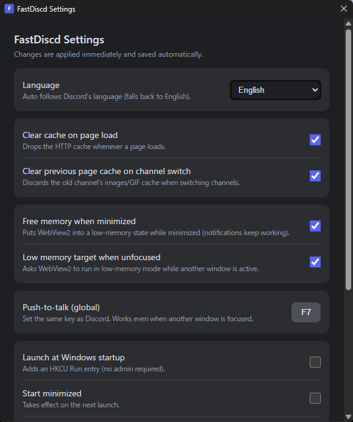
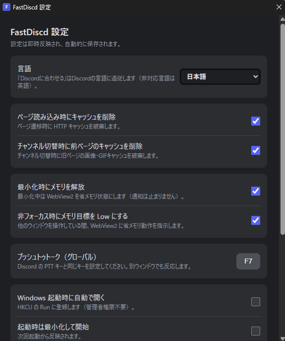

# FastDiscd

A lightweight desktop client for Discord, built with **Rust + Windows' built-in WebView2**.


> **⚠️ IMPORTANT — please read**
>
> - This is an **unofficial client, not affiliated with Discord Inc.** in any way.
> - Using it **may violate Discord's Terms of Service. Use entirely at your own risk.**
> - This is a **beta release**. Features and distribution may change without notice.
> - **Windows only** (Windows 10/11 x64).

---

## Screenshots

| English | 日本語 |
| --- | --- |
|  |  |

---

## Feature support

| Feature | Status | Notes |
| --- | --- | --- |
| UI / layout | ✅ Full | Discord's official web app rendered as-is (no custom UI) |
| Sending / receiving messages | ✅ Full | Uses Discord Web's own Gateway (WebSocket) and REST |
| Images, GIFs, stickers, emoji | ✅ Full | Rendered by WebView2 |
| Voice chat | ✅ Works | WebRTC; microphone permission auto-granted; Discord's voice settings apply |
| Notifications | ✅ Works | Windows toast notifications via WebView2 (permission auto-granted) |
| Push-to-talk | ✅ Enhanced | **Works globally** — talking works even when another window is focused (key polling in Rust) |
| Screen sharing | △ Experimental | Custom capture pipeline. Unstable or non-functional in app mode |
| Global hotkeys (mute, etc.) | △ Partial | PTT only; other actions planned |
| Zoom level | ✅ Custom | Discord's web app has no zoom setting, so FastDiscd provides its own |
| Startup behavior / tray | ✅ Full | Launch at login, start minimized, minimize to tray, GPU toggle |
| Rich Presence / game detection | ❌ Not supported | Requires `DiscordNative` |
| Drag & drop files into chat | ✅ Works | WebView2 native file drop is enabled |
| Auto-update | — | Discord's web app is always current; the app itself is updated manually |

---

## Memory management system

The Electron client bundles Chromium and Node.js with every app. FastDiscd instead
**shares the OS WebView2 runtime** and uses Rust to control how aggressively memory is released.

### Layer 1 — Minimal native shell
- No bundled Electron or Node.js (the Rust binary is ~5 MB)
- Chromium is shared through the system WebView2 runtime

### Layer 2 — Focus-aware memory target
- The moment the window becomes **unfocused or minimized**, FastDiscd calls
  `ICoreWebView2_19::SetMemoryUsageTargetLevel(Low)`
- Restores `Normal` when focus returns
- This is an official API that tells Chromium to operate in a low-memory mode

### Layer 3 — Background throttling
- Tauri's `background_throttling = Suspend`
- Renderer tasks stop while hidden, reducing both CPU and memory use

### Layer 4 — Cache purging on page / channel changes
- Clears the HTTP disk cache on every page load (`ClearBrowsingData(DISK_CACHE)`)
- Detects **channel switches** (SPA route changes) and discards the previous page's cache
- Forces a V8 heap GC (`HeapProfiler.collectGarbage`) so the previous channel's messages are released
- Every part can be toggled in the settings

### Layer 5 — Reuse a single window
- No new windows per action; the WebView2 profile and processes are shared
- The settings window is **pre-created hidden at startup**, so it opens instantly from the tray

### Measured results (this PC / Windows 11 / logged in)

| State | Total memory |
| --- | --- |
| **Unfocused (working in another window)** | **~107 MB** |
| **Focused (normal use)** | **~414 MB** |
| Reference: official Discord (Electron) | ~1,000–1,500 MB |

**Unfocused (107.1 MB) breakdown**

| Process | Usage |
| --- | --- |
| WebView2 (1) Discord | 72.6 MB |
| WebView2 manager | 15.6 MB |
| WebView2 GPU process | 8.7 MB |
| Network Service | 5.8 MB |
| Crashpad | 2.0 MB |
| Audio Service | 1.8 MB |
| Storage Service | 0.7 MB |

**Focused (414.4 MB) breakdown**

| Process | Usage |
| --- | --- |
| WebView2 (1) Discord | 294.7 MB |
| GPU process | 75.9 MB |
| WebView2 manager | 25.4 MB |
| Network Service | 13.7 MB |
| Crashpad | 2.0 MB |
| Audio Service | 1.3 MB |
| Storage Service | 1.3 MB |

> Memory drops this far when unfocused because the low memory target, background throttling,
> and cache purging work together. In short: Discord is put to sleep when you are not using it.

---

## Installation

1. Download `FastDiscd_0.1.0_x64-setup.exe` from [Releases](../../releases)
2. Run it (administrator rights required; installs to `Program Files\FastDiscd`)
3. Launch **FastDiscd** from the desktop or Start menu

Log in to Discord on first launch. You will stay logged in afterwards.

The installer asks you to choose English or Japanese.


## Startup mode (Settings → Startup mode)

| Mode | Description |
| --- | --- |
| **Browser (recommended)** | Loads Discord with a standard Chrome user agent. Most stable; screen sharing uses the custom capture pipeline. |
| App (experimental) | Loads Discord with the official desktop user agent. Emulates `DiscordNative`; **screen sharing may be unstable or not work at all**, and other features may break. It is automatically disabled after repeated JS errors. |

**Memory management is identical in both modes** — the memory system (focus-aware low-memory target,
background throttling, cache purging) is implemented in Rust/WebView2 and does not depend on the user agent.
## Settings

**Right-click the FastDiscd icon in the system tray → "Settings..."** (left-click restores the main window).

| Option | Description |
|---|---|
| Language | Auto (match Discord) / English / Japanese. Unsupported languages fall back to English |
| Clear cache on page load | Drops the HTTP cache whenever a page loads |
| Clear previous page cache on channel switch | Discards the old channel's cache (and runs GC) |
| Free memory when minimized | Puts WebView2 into a low-memory state while minimized |
| Low memory target when unfocused | Requests low-memory mode while another window is active |
| Push-to-talk (global) | Register the same key as Discord to talk while another window is focused |
| Launch at Windows startup | Registers an HKCU Run entry |
| Start minimized | Takes effect on the next launch |
| Minimize to tray | Restore by left-clicking the tray icon |
| Hardware acceleration | Takes effect after a restart |
| Zoom level | Substitute for Discord's unavailable zoom setting |

## Building

Requirements:

- Rust (stable-msvc)
- Visual Studio Build Tools (C++ workload)
- Node.js + pnpm
- WebView2 Runtime (included in Windows 11)

```powershell
pnpm install
pnpm tauri build
# Installer: src-tauri/target/release/bundle/nsis/FastDiscd_0.1.0_x64-setup.exe
```

## Data location

```
%LOCALAPPDATA%\FastDiscd
 ├─ EBWebView\     login session / cookies
 ├─ config.json    settings
 └─ fastdiscd.log  runtime log
```

## Known limitations

- Screen sharing is experimental and may not work depending on Discord's client-side detection
- Some Discord settings (anything `DiscordNative`-dependent) do not exist on the web, so FastDiscd provides its own substitutes
- The icons of WebView2 child processes in Task Manager belong to the Edge/WebView2 runtime and cannot be changed

## Disclaimer

This software is provided "as is", without warranty of any kind.
The author is not responsible for any damage or account suspension resulting from its use.
Please review Discord's Terms of Service and use at your own risk.

## License

MIT (see `LICENSE`). "Discord" and its logo are trademarks of Discord Inc.
See [docs/LEGAL.md](docs/LEGAL.md) for details.
