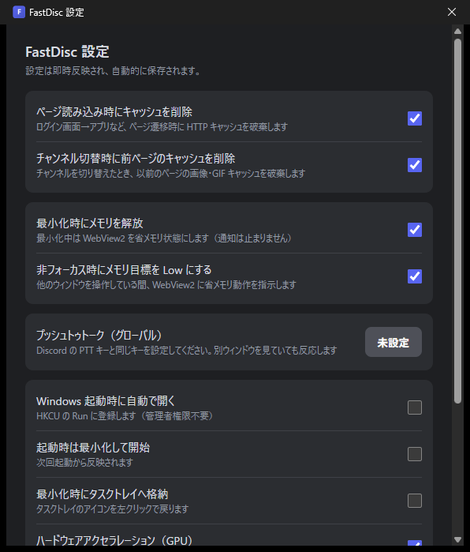

# FastDiscd

Discord の Electron クライアントを、**Rust + Windows 標準の WebView2** で包み直した軽量デスクトップクライアントです。


> **⚠️ 重要（必ずお読みください）**
>
> - 本アプリは **Discord Inc. とは一切関係のない非公式クライアント**です。
> - **Discord の利用規約（ToS）に違反する可能性があります。** 利用は**完全に自己責任**でお願いします。
> - **現在はベータ版**です。予告なく仕様変更・配布終了する場合があります。
> - **対応 OS は Windows のみ**（Windows 10/11 x64）です。

## スクリーンショット

| 設定画面（トレイ → 設定...） |
| --- |
|  |

## 特徴

- **UI は Discord 公式 Web のまま**（`https://discord.com/app` を表示）
- **メッセージ送受信は従来どおり**（WebView2 内の Discord Web クライアントが Gateway / REST をそのまま使用）
- Rust 側はシェルと OS 連携のみ（Discord API の実装は一切なし）
- frameless ウィンドウ + 独自タイトルバー（右上に最小化 / 最大化 / 閉じる）
- ログイン状態の保持、マイク・カメラ・通知の権限自動許可
- **グローバル プッシュトゥトーク**（別ウィンドウを見ていても送話可能）
- 省メモリ動作（非フォーカス時に WebView2 へ Low メモリ指示）
- キャッシュ管理（ページ読み込み時 / チャンネル切替時に削除、ON/OFF 可）
- 拡大率（50〜200%）
- 自動起動 / 起動時最小化 / トレイ格納 / ハードウェアアクセラレーション切替

## インストール

1. [Releases](../../releases) から `FastDiscd_0.1.0_x64-setup.exe` をダウンロード
2. 実行（管理者権限が必要です。`Program Files\FastDiscd` にインストールされます）
3. デスクトップ / スタートメニューの **FastDiscd** から起動

初回起動時に Discord にログインしてください。以降は自動ログインします。

## 設定方法

タスクトレイの **FastDiscd アイコンを右クリック →「設定...」** で設定ウィンドウが開きます。
（左クリックでメインウィンドウを復帰）

| 項目 | 説明 |
|---|---|
| ページ読み込み時にキャッシュを削除 | ページ遷移時に HTTP キャッシュを破棄 |
| チャンネル切替時に前ページのキャッシュを削除 | チャンネルを変えたとき旧ページのキャッシュを破棄 |
| 最小化時にメモリを解放 | 最小化中は WebView2 を省メモリ状態にする |
| 非フォーカス時にメモリ目標を Low にする | 他ウィンドウ操作中に省メモリ指示 |
| プッシュトゥトーク（グローバル） | Discord 側と同じキーを登録すると、別ウィンドウでも送話できる |
| Windows 起動時に自動で開く | HKCU の Run に登録 |
| 起動時は最小化して開始 | 次回起動から反映 |
| 最小化時にタスクトレイへ格納 | トレイアイコン左クリックで復帰 |
| ハードウェアアクセラレーション | オフは再起動後に反映 |
| 拡大率 | Discord Web 側に拡大率設定が無いための代替 |

## メモリ使用量（参考）

| 状態 | 合計 |
| --- | --- |
| 非フォーカス時 | 約 107MB |
| フォーカス時（通常利用） | 約 414MB |

※ WebView2 の子プロセス（GPU / Audio / Network 等）を含む合計。表示内容により変動します。

## ビルド

必要なもの:

- Rust（stable-msvc）
- Visual Studio Build Tools（C++ ワークロード）
- Node.js + pnpm
- WebView2 ランタイム（Windows 11 は標準）

```powershell
pnpm install
pnpm tauri build
# インストーラ: src-tauri/target/release/bundle/nsis/FastDiscd_0.1.0_x64-setup.exe
```

## データの場所

```
%LOCALAPPDATA%\FastDiscd
 ├─ EBWebView\     ログイン情報・Cookie
 ├─ config.json    設定
 └─ fastdisc.log   動作ログ
```

## 既知の制限

- 画面共有は WebView2 の制約で不可
- Discord の一部設定（`DiscordNative` 依存の項目）は Web 側に存在しないため、本アプリ独自の設定で代替
- タスクマネージャー上の WebView2 子プロセスのアイコンは Edge/WebView2 ランタイムのもので、変更できません

## 免責

本ソフトウェアは現状のまま提供され、いかなる保証もありません。
利用により発生した損害・アカウント停止等について、作者は一切責任を負いません。
Discord の利用規約を確認のうえ、自己責任でご利用ください。

## ライセンス

MIT（`LICENSE` 参照）。Discord の名称・ロゴは Discord Inc. の商標です。
詳細は [docs/LEGAL.md](docs/LEGAL.md) を参照してください。
