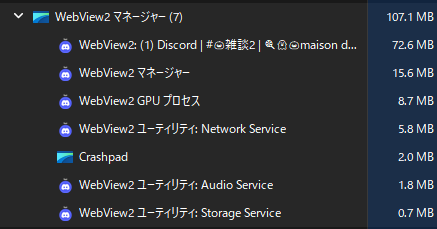
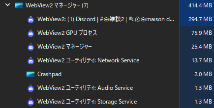

# FastDiscd

Discord の Electron クライアントを、**Rust + Windows 標準の WebView2** で包み直した軽量デスクトップクライアントです。


> **⚠️ 重要（必ずお読みください）**
>
> - 本アプリは **Discord Inc. とは一切関係のない非公式クライアント**です。
> - **Discord の利用規約（ToS）に違反する可能性があります。** 利用は**完全に自己責任**でお願いします。
> - **現在はベータ版**です。予告なく仕様変更・配布終了する場合があります。
> - **対応 OS は Windows のみ**（Windows 10/11 x64）です。

---

## スクリーンショット

| 設定画面（トレイ → 設定...） |
| --- |
|  |

---

## Discord 機能の対応状況

| 機能 | 状態 | 説明 |
| --- | --- | --- |
| UI・レイアウト | ✅ 完全 | Discord 公式 Web をそのまま表示（独自 UI なし） |
| メッセージ送受信 | ✅ 完全 | Discord Web の Gateway(WebSocket) / REST をそのまま使用 |
| 画像・GIF・スタンプ・絵文字 | ✅ 完全 | WebView2 が描画 |
| ボイスチャット | ✅ 動作 | WebRTC。マイク権限は自動許可。Discord の音声設定もそのまま |
| 通知 | ✅ 動作 | WebView2 の Windows トースト経由（権限自動許可） |
| プッシュトゥトーク | ✅ 強化 | **グローバル対応**。別ウィンドウを見ていても送話できる（Rust 側でキー監視） |
| 画面共有 | ❌ 不可 | WebView2 の制約（`getDisplayMedia` のピッカー UI が無い） |
| グローバルホットキー（ミュート等） | △ 一部 | PTT は対応。他のアクションは今後の対応 |
| 拡大率 | ✅ 代替実装 | Discord Web には無いため、アプリ独自の拡大率設定で代替 |
| 起動時の動作 / トレイ格納 | ✅ 完全 | 自動起動・最小化起動・トレイ格納・GPU切替を実装 |
| リッチプレゼンス / ゲーム検出 | ❌ 不可 | `DiscordNative` 依存のため |
| 自動更新 | — | Discord Web 側は常に最新。アプリは手動更新 |

---

## メモリ管理システム（FastDiscd の肝）

Electron 版は Chromium と Node.js をアプリごとに同梱しますが、FastDiscd は **OS の WebView2 を共有**し、
Rust 側でメモリの「寝かせ方」を細かく制御しています。

### レイヤー1: 軽量なネイティブシェル
- Electron / Node.js を同梱しない（Rust バイナリは約 5MB）
- Chromium は OS の WebView2 ランタイムを共有（アプリごとに持たない）

### レイヤー2: フォーカス連動のメモリ目標制御
- ウィンドウが**非フォーカス**または**最小化**された瞬間に
  `ICoreWebView2_19::SetMemoryUsageTargetLevel(Low)` を発行
- フォーカスが戻ると `Normal` に戻す
- Chromium に「今は省メモリで動け」と明示的に指示できる公式 API

### レイヤー3: バックグラウンドスロットリング
- Tauri の `background_throttling = Suspend`
- 非表示状態ではレンダラのタスクを停止し、CPU とメモリの消費を抑制

### レイヤー4: ページ・チャンネル切替時のキャッシュ破棄
- ページ読み込み完了時に HTTP ディスクキャッシュを削除（`ClearBrowsingData(DISK_CACHE)`）
- **チャンネル切替**（SPA のルート変更）を検知して、旧ページのキャッシュを破棄
- 同時に V8 ヒープの GC を強制（`HeapProfiler.collectGarbage`）し、前チャンネルのメッセージを解放
- すべて設定で ON/OFF 可能

### レイヤー5: ウィンドウ1枚を使い回す
- 新しいウィンドウを都度生成せず、WebView2 のプロファイルとプロセスを共有
- 設定ウィンドウは起動時に**非表示で事前生成**し、トレイから一瞬で開けるようにしている

### 実測値（この PC / Windows 11 / ログイン済み）

| 状態 | 合計メモリ |
| --- | --- |
| **非フォーカス時（他ウィンドウ操作中）** | **約 107MB** |
| **フォーカス時（通常利用）** | **約 414MB** |
| 参考: Discord 公式 Electron 版 | 約 1,000〜1,500MB |

**非フォーカス時（107.1MB）の内訳**



| プロセス | 使用量 |
| --- | --- |
| WebView2 (1) Discord | 72.6MB |
| WebView2 マネージャー | 15.6MB |
| WebView2 GPU プロセス | 8.7MB |
| Network Service | 5.8MB |
| Crashpad | 2.0MB |
| Audio Service | 1.8MB |
| Storage Service | 0.7MB |

**フォーカス時（414.4MB）の内訳**



| プロセス | 使用量 |
| --- | --- |
| WebView2 (1) Discord | 294.7MB |
| GPU プロセス | 75.9MB |
| WebView2 マネージャー | 25.4MB |
| Network Service | 13.7MB |
| Crashpad | 2.0MB |
| Audio Service | 1.3MB |
| Storage Service | 1.3MB |

> 非フォーカス時にここまで下がるのは、メモリ目標の Low 化とバックグラウンド制御、
> キャッシュ破棄を組み合わせているためです。Discord を「使っていないときは寝かせる」設計です。

---

## インストール

1. [Releases](../../releases) から `FastDiscd_0.1.0_x64-setup.exe` をダウンロード
2. 実行（管理者権限が必要です。`Program Files\FastDiscd` にインストールされます）
3. デスクトップ / スタートメニューの **FastDiscd** から起動

初回起動時に Discord にログインしてください。以降は自動ログインします。

## 設定方法

タスクトレイの **FastDiscd アイコンを右クリック →「設定...」** で設定ウィンドウが開きます。
（左クリックでメインウィンドウを復帰）

| 項目 | 説明 |
|---|---|
| ページ読み込み時にキャッシュを削除 | ページ遷移時に HTTP キャッシュを破棄 |
| チャンネル切替時に前ページのキャッシュを削除 | チャンネルを変えたとき旧ページのキャッシュを破棄（GC も実行） |
| 最小化時にメモリを解放 | 最小化中は WebView2 を省メモリ状態にする |
| 非フォーカス時にメモリ目標を Low にする | 他ウィンドウ操作中に省メモリ指示 |
| プッシュトゥトーク（グローバル） | Discord 側と同じキーを登録すると、別ウィンドウでも送話できる |
| Windows 起動時に自動で開く | HKCU の Run に登録 |
| 起動時は最小化して開始 | 次回起動から反映 |
| 最小化時にタスクトレイへ格納 | トレイアイコン左クリックで復帰 |
| ハードウェアアクセラレーション | オフは再起動後に反映 |
| 拡大率 | Discord Web 側に拡大率設定が無いための代替 |

## ビルド

必要なもの:

- Rust（stable-msvc）
- Visual Studio Build Tools（C++ ワークロード）
- Node.js + pnpm
- WebView2 ランタイム（Windows 11 は標準）

```powershell
pnpm install
pnpm tauri build
# インストーラ: src-tauri/target/release/bundle/nsis/FastDiscd_0.1.0_x64-setup.exe
```

## データの場所

```
%LOCALAPPDATA%\FastDiscd
 ├─ EBWebView\     ログイン情報・Cookie
 ├─ config.json    設定
 └─ fastdiscd.log  動作ログ
```

## 既知の制限

- 画面共有は WebView2 の制約で不可
- Discord の一部設定（`DiscordNative` 依存の項目）は Web 側に存在しないため、本アプリ独自の設定で代替
- タスクマネージャー上の WebView2 子プロセスのアイコンは Edge/WebView2 ランタイムのもので、変更できません

## 免責

本ソフトウェアは現状のまま提供され、いかなる保証もありません。
利用により発生した損害・アカウント停止等について、作者は一切責任を負いません。
Discord の利用規約を確認のうえ、自己責任でご利用ください。

## ライセンス

MIT（`LICENSE` 参照）。Discord の名称・ロゴは Discord Inc. の商標です。
詳細は [docs/LEGAL.md](docs/LEGAL.md) を参照してください。
